# Secure Remote Access: Fedora → Windows 11 over Tailscale + Mullvad

> [!NOTE]
> **TL;DR:** I built an encrypted remote desktop setup that lets my Fedora (Hyprland) ThinkPad connect to my Windows 11 Pro laptop from any public Wi-Fi, without exposing RDP to the internet. Both machines send their internet traffic through Mullvad VPN, so neither the public network nor my home ISP can see what I'm doing. Getting there meant working through an authentication failure, a VPN-vs-mesh-network conflict, and exit node routing mistakes. All of it is documented below with screenshots.

> [!IMPORTANT]
> I used an AI assistant for research and as a troubleshooting partner. All installation, configuration, testing, and debugging was done by me on my own hardware. Screenshots are from my machines, with IPs, usernames, and hostnames redacted.

---

## 1. Overview

### Problem
I had just installed Fedora with Hyprland on my ThinkPad and needed to remote into my Windows 11 laptop at home. On my previous Debian-based setup (Kali), I used Chrome Remote Desktop with the standalone Mullvad app on both machines. That workflow didn't carry over cleanly to Fedora: the Chrome Remote Desktop **host** package is Debian-only, so I used the switch as a chance to build something more secure that I actually understood.

### Goals
1. Connect from my Fedora laptop on **any public Wi-Fi** (library, coffee shop) to my Windows laptop over an **encrypted** RDP session.
2. Have the Windows laptop's own internet traffic **encrypted and hidden from my ISP**.
3. Keep it **reliable**. If it breaks while I'm away from home, I can't fix it.

### Non-negotiables (security requirements)
- **Never port-forward RDP (TCP 3389) to the internet.** It is one of the most attacked services there is.
- **Use a private overlay network** for access from outside home. I chose **Tailscale** (WireGuard-based) over raw WireGuard for easier key management, NAT traversal, and device management.
- **Strong account password, Network Level Authentication (NLA) on, Windows kept up to date.**

> [!TIP]
> NLA makes the client authenticate *before* a full RDP session is created, which shrinks the attack surface. It is **not** a replacement for MFA, but it is strictly better than having it off.

---

## 2. Options Considered

| Option                              | Pros                                                               | Cons                                           | Verdict                          |
| ----------------------------------- | ------------------------------------------------------------------ | ---------------------------------------------- | -------------------------------- |
| **Windows RDP + FreeRDP / Remmina** | Native, fast, full-featured (clipboard, audio, dynamic resolution) | Needs Windows Pro as host                      | **Chosen** (I have Windows Pro)  |
| RustDesk                            | Open source, works on Windows Home, self-hostable relay            | Extra software; relay trust if not self-hosted | Backup option                    |
| Chrome Remote Desktop (browser)     | Zero setup; browser client still works on Fedora                   | Fewer features, tied to a Google account       | Fallback                         |
| Sunshine + Moonlight                | Very low latency, great for gaming                                 | Overkill for general remote work               | Not needed                       |
| OpenSSH                             | Lightweight, scriptable                                            | Terminal only                                  | Complementary, not a replacement |

---

## 3. Final Architecture

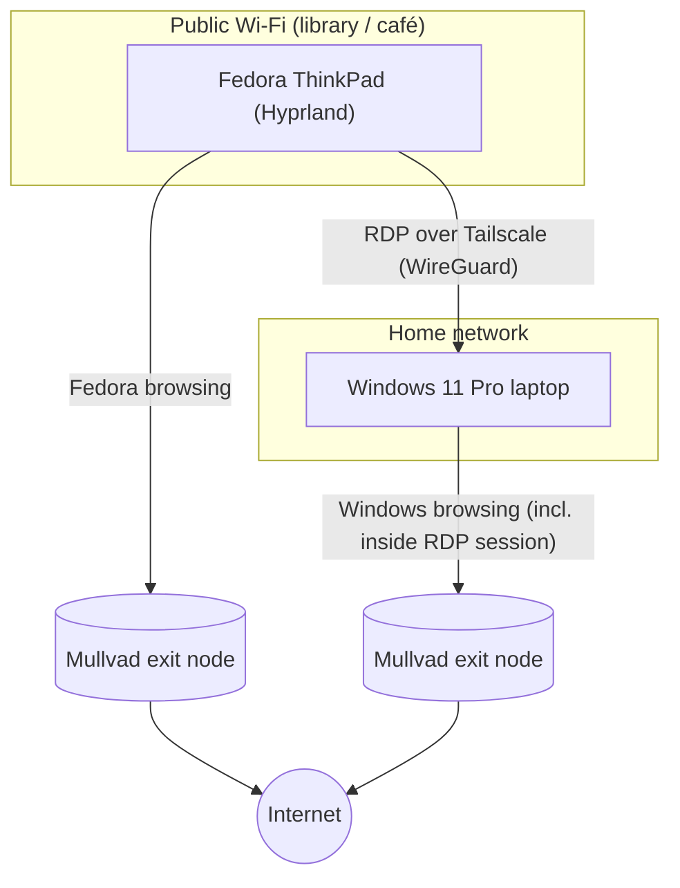

There are **three separate traffic paths**:

1. **RDP:** Fedora → encrypted Tailscale tunnel → Windows. Device-to-device traffic stays inside the tailnet and **does not** go through the exit node.
2. **Fedora browsing:** public Wi-Fi → encrypted → Mullvad exit node → internet.
3. **Windows browsing** (including anything I do inside the RDP session): home ISP → encrypted → Mullvad exit node → internet.

### What each party can see

| Observer | Visibility |
|---|---|
| Public Wi-Fi operator | Encrypted traffic only. Can't tell I'm using RDP or which sites I visit |
| Home ISP | Encrypted traffic to Tailscale / Mullvad only |
| Websites | A Mullvad IP address, never my home or public Wi-Fi IP |
| The internet at large | No open RDP port. 3389 is never exposed |

---

## 4. Implementation

### 4.1 Prepare Windows 11 Pro

1. **Enable Remote Desktop:** Settings → System → Remote Desktop → **On**. Keep *Require devices to use Network Level Authentication* checked.

   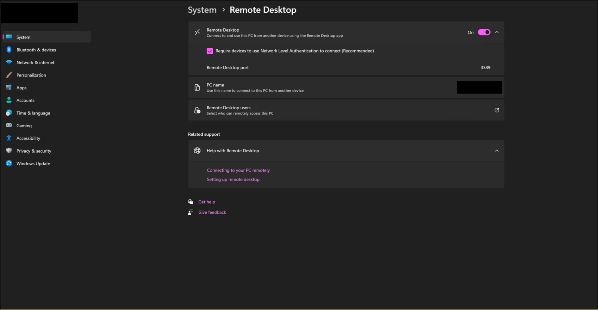

2. **Make sure the account supports password logins.** RDP does not accept a Windows Hello PIN.
   - Signed in with my Microsoft account and verified the password by signing out and back in with it (not the PIN).
   - Settings → Accounts → Sign-in options → **turned off** *"For improved security, only allow Windows Hello sign-in for Microsoft accounts on this device."* This setting silently blocks RDP password logins.

   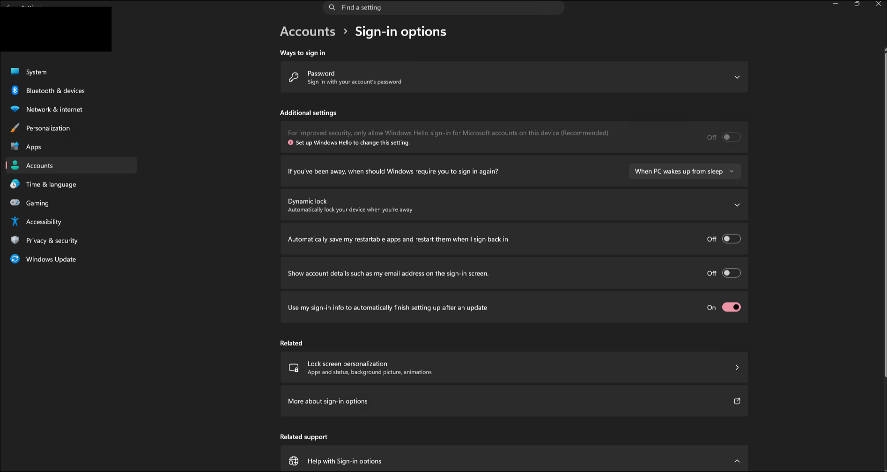

3. **Prevent sleep:** Settings → System → Power → Screen and sleep → *When plugged in, put my device to sleep after* → **Never**. Screen-off is fine; a sleeping machine can't be reached.

   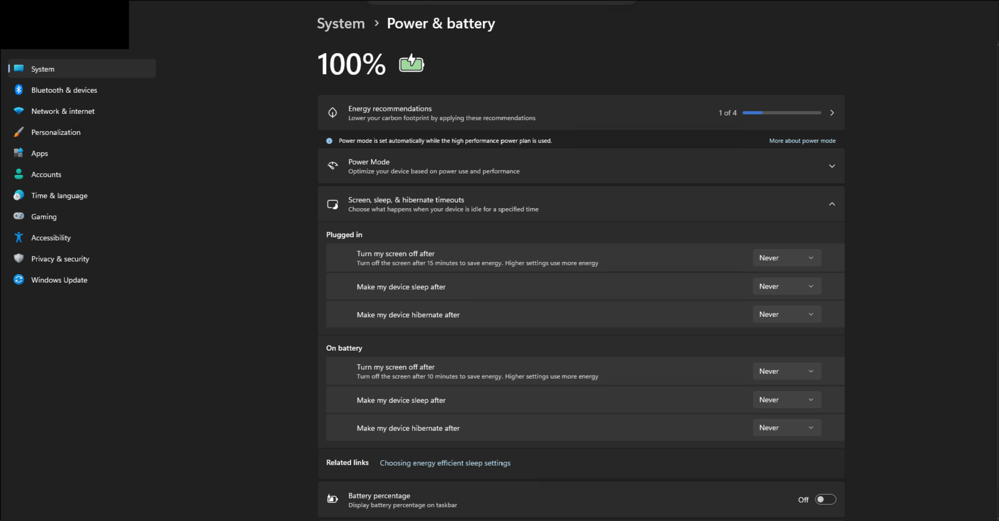

4. **Install Tailscale:** downloaded from tailscale.com, signed in, and enabled **Run unattended** from the tray icon so it stays connected across reboots and sign-outs.

   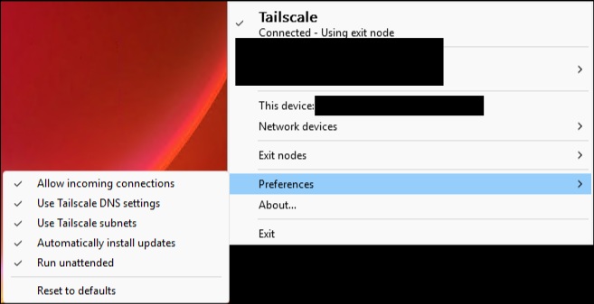

### 4.2 Set up Tailscale on Fedora

```bash
sudo dnf install freerdp remmina tailscale
sudo systemctl enable --now tailscaled
sudo tailscale up                       # prints a login URL; same account as Windows
sudo tailscale set --operator=$USER     # run tailscale commands without sudo
tailscale status                        # confirm the Windows machine is listed
```

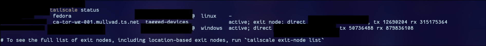

### 4.3 First RDP connection

```bash
xfreerdp /v:<WINDOWS_TAILSCALE_IP> /u:<windows-username> \
  /dynamic-resolution +clipboard /sound /network:auto /cert:tofu
```

| Flag | Purpose |
|---|---|
| `/dynamic-resolution` | Remote desktop resizes with the local window |
| `+clipboard` | Shared clipboard |
| `/sound` | Remote audio plays locally |
| `/network:auto` | Adapts quality to the connection (important on public Wi-Fi) |
| `/cert:tofu` | *Trust on first use*: accepts the host certificate once, then warns if it ever changes |

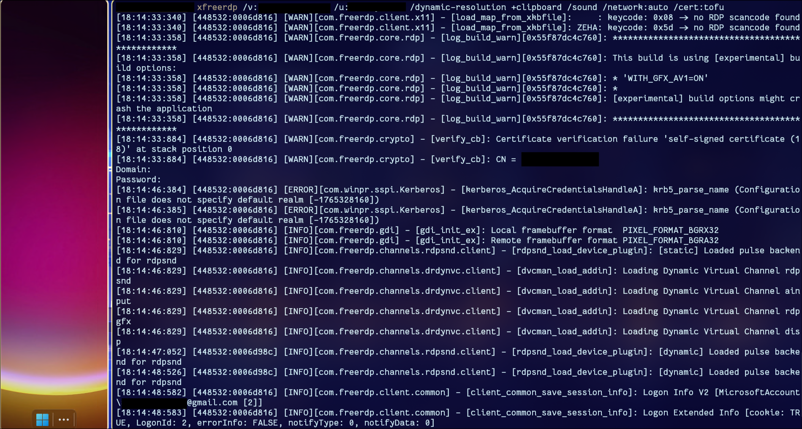

For convenience, I added a shell alias and a saved Remmina profile.

### 4.4 Hardening

- **Restricted RDP to Tailscale only:** Windows Firewall now accepts RDP exclusively from Tailscale's address range:
  ```powershell
  Set-NetFirewallRule -DisplayGroup "Remote Desktop" -RemoteAddress 100.64.0.0/10
  ```

  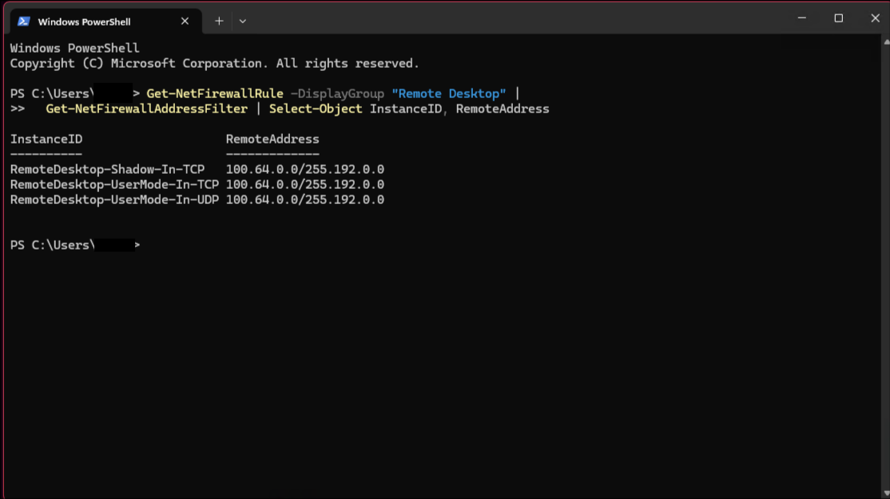

  **Proof it works:** from the same home network, port 3389 is blocked on the Windows machine's LAN IP but open on its Tailscale IP. Windows displays /10 in subnet-mask notation (255.192.0.0).

  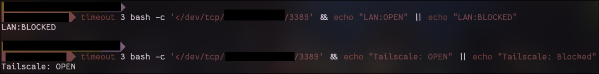

- **Disabled Tailscale key expiry** for the Windows machine in the admin console. Otherwise it forces re-authentication every 180 days, which could lock me out while I'm away.

### 4.5 Encrypted internet for both machines: Mullvad via Tailscale exit nodes

Running the standalone Mullvad app alongside Tailscale broke connectivity (see Issue 3 below). The fix was Tailscale's **Mullvad VPN add-on**, which exposes Mullvad servers as **exit nodes** inside Tailscale. One network stack manages both the private tunnel and the VPN, so nothing conflicts.

1. Purchased the add-on in the Tailscale admin console and added both devices to it (one license covers up to 5 devices).
2. **Windows (PowerShell, admin):**
   ```powershell
   tailscale set --advertise-exit-node=false      # undo earlier experiment
   tailscale exit-node list | Select-String "Toronto"
   tailscale set --exit-node=<mullvad-node> --exit-node-allow-lan-access=true
   curl.exe ifconfig.me                           # should show a Mullvad IP
   ```
3. **Fedora:**
   ```bash
   tailscale set --exit-node=                     # clear previous exit node
   tailscale exit-node list | grep -i toronto
   tailscale set --exit-node=<mullvad-node> --exit-node-allow-lan-access=true
   curl ifconfig.me                               # should show a Mullvad IP
   ```

`--exit-node-allow-lan-access` keeps local devices such as printers and the router reachable while the VPN is on.

> [!WARNING]
> Mullvad exit nodes need UDP. On networks that block it, see Issue 5 for the fallback.


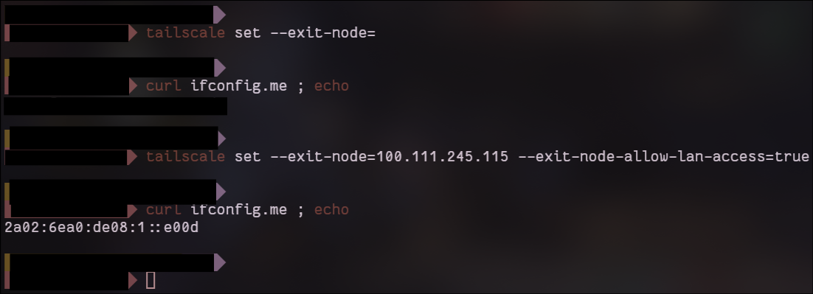

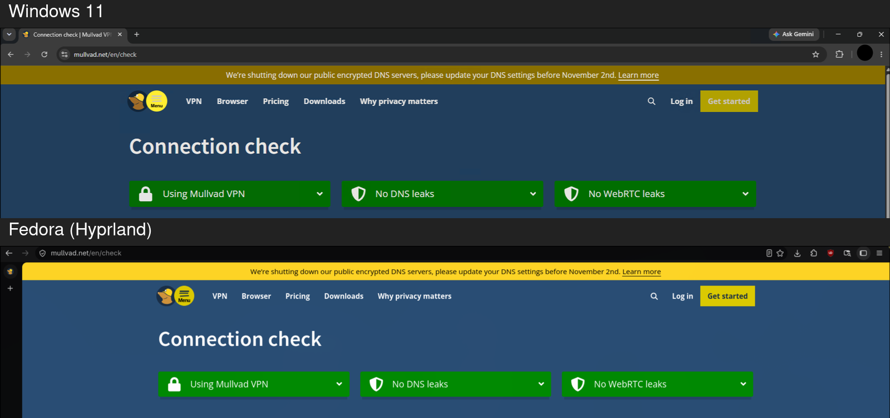

---

## 5. Troubleshooting Log

### Issue 1: `tailscale update` failed on Fedora
- **Symptom:** `sudo tailscale update` errored trying to open `/etc/yum.repos.d/tailscale.repo` (no such file), and `dnf upgrade tailscale` reported nothing to do.
- **Root cause:** I had installed Tailscale from **Fedora's own repos**, which lag behind upstream. The built-in updater only works when Tailscale is installed from **Tailscale's official repo**.
- **Fix:**
  ```bash
  sudo dnf config-manager addrepo --from-repofile=https://pkgs.tailscale.com/stable/fedora/tailscale.repo
  sudo dnf upgrade --refresh tailscale
  sudo systemctl restart tailscaled
  ```

  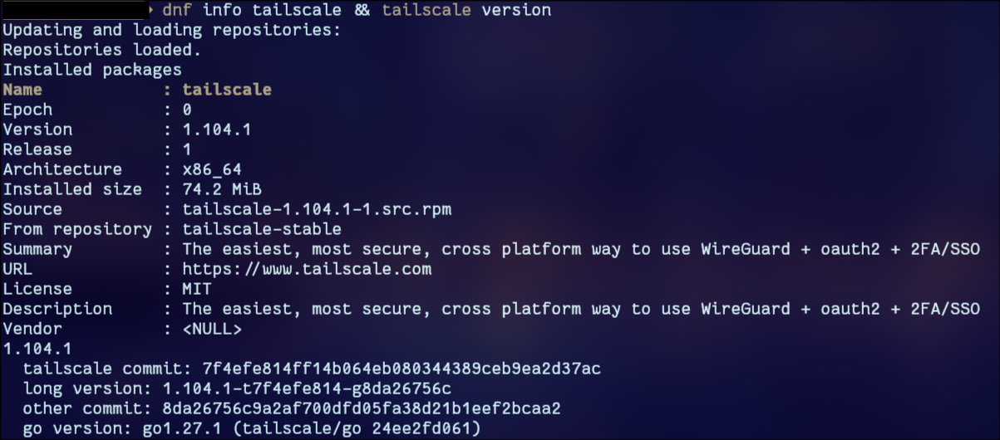

- **Lesson:** Know where a package comes from. Distro-packaged and vendor-packaged versions update differently.

### Issue 2: RDP `ERRCONNECT_LOGON_FAILURE`
- **Symptom:** Every FreeRDP variant (`xfreerdp`, `wlfreerdp`, `sdl-freerdp`) failed after the password prompt. The logs showed repeated Kerberos errors: `Cannot find KDC for realm "GMAIL.COM"`.

  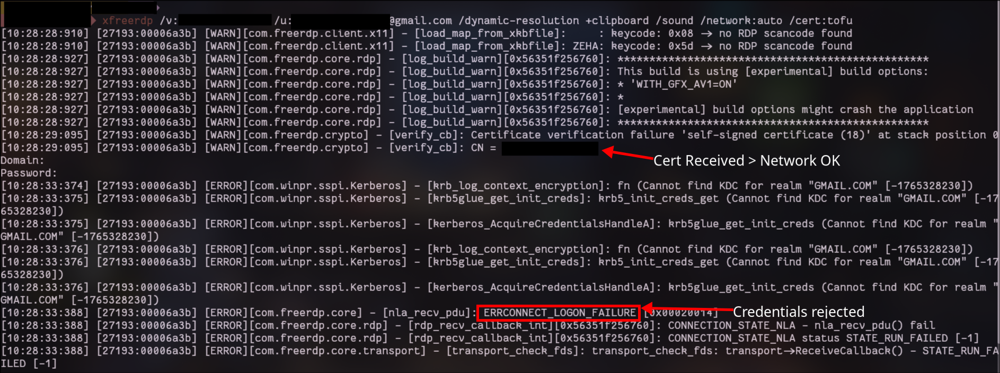

- **Diagnosis:**
  - The log showed the server's certificate (`CN = <windows-hostname>`) arriving, which proved **the network path, Tailscale, and the firewall were all working**. The problem was isolated to **authentication**.
  - Logging in as `user@gmail.com` made FreeRDP treat `GMAIL.COM` as a corporate Kerberos realm. It failed that, fell back to NTLM, and the credentials were still rejected.
  - Adding the `MicrosoftAccount\` prefix and excluding Kerberos (`/auth-pkg-list:'!kerberos'`) didn't help, so the credentials themselves were the issue.
- **Root cause:** A combination of the Windows Hello-only sign-in policy and using the email address as the username.
- **Fix:** Disabled Hello-only sign-in, signed in locally once with the password, ran `whoami` on Windows to get the **local profile username**, and connected with that username plus the Microsoft account password. 
- **Lesson:** Read the logs in order. A received certificate rules out the network layer, and the error code (`LOGON_FAILURE` vs `CONNECT_TRANSPORT_FAILED`) tells you which layer to debug.

### Issue 3: Windows dropped off the tailnet when Mullvad was on
- **Symptom:** After applying the firewall rule, the Windows machine showed "last seen a few minutes ago" in Tailscale and became unreachable. The machine itself was still running; it had lost its Tailscale connection.
- **First suspicions ruled out:**
  - *Disabling key expiry* can't take a device offline.
  - *The firewall rule* only affects inbound RDP, not Tailscale's own connection to its control server.
- **Diagnosis:** The standalone Mullvad app on Windows had been connected. Even with all three Tailscale executables added to Mullvad's split tunneling list and the service restarted (`Restart-Service Tailscale`), `tailscale status` showed:
  ```
  You are logged out. The last login error was: fetch control key:
  ... dial tcp [2606:...]:443: connectex: A socket operation was attempted to an unreachable network.
  ```
  Disconnecting Mullvad brought the machine straight back online, which confirmed the cause.

  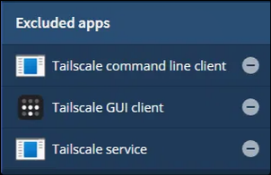

  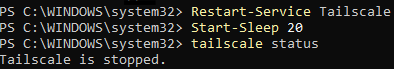

- **Root cause:** Both Mullvad and Tailscale are WireGuard-based and both try to control routing and the firewall. Mullvad's firewall blocked Tailscale's traffic, and split tunneling didn't reliably exempt the Tailscale service.
- **Options evaluated:**

  | Option | Outcome |
  |---|---|
  | Split tunneling + service restart | Failed; fragile across reboots |
  | Home machine as exit node | Protects from public Wi-Fi but **not from the ISP**, since traffic still leaves through the home connection |
  | Tailscale userspace networking + SOCKS5 proxy (community workaround) | Viable for a Linux *client*, but unsupported on the Windows *host*, and doesn't apply on Android (one VPN at a time) |
  | **Tailscale Mullvad add-on** | One stack, no conflict, same cost as a standalone Mullvad subscription |

- **Lesson:** Two tools that each want to own routing will fight. Prefer an integrated solution over workarounds, especially on a machine you can't physically reach.

### Issue 4: Exit node configuration mistakes
- **`invalid value for --exit-node`:** I tried to set the Windows machine as its **own** exit node. A device can't route through itself.
- **`Cannot advertise an exit node and use an exit node at the same time`:** Windows was still advertising itself as an exit node from an earlier experiment. Fixed with `tailscale set --advertise-exit-node=false`.
- **`zsh: Select-String: command not found`:** `Select-String` is PowerShell. On Linux, the equivalent is `grep`.
- **`curl ifconfig.me` showed my home IP even with an exit node set:** I was routing through my home machine *while at home*, so the IP was identical either way. Switching to Mullvad exit nodes produced a different IP, as expected.
- **Admin console said Windows was "not advertising as an exit node":** Correct and expected after disabling advertising. The *Use as exit node* approval only applies to devices that offer themselves as exit nodes. **Using** a Mullvad exit node is a separate setting.

  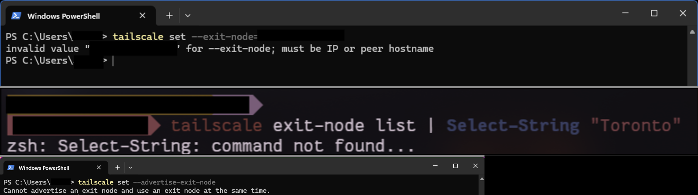

- **Lesson:** Keep *advertising* an exit node (offering one) and *using* an exit node (consuming one) clearly separate in your head.

### Issue 5: Mullvad exit node unusable on public library Wi-Fi (UDP blocked)
- **Symptom:** On a public library's Wi-Fi, the internet worked with the exit node off, but with the Mullvad exit node on, nothing loaded. RDP to the Windows host over Tailscale still worked.
- **Ruled out:**
  - *Re-authenticating Tailscale* (`tailscale down` / `tailscale up`): no change.
  - *DNS:* tried `tailscale set --accept-dns=false`, with no change. Reverted it afterwards, because it sends DNS lookups to the public network's resolver, which leaks the sites I visit to the network operator.
- **Diagnosis:** `tailscale netcheck` reported **`UDP: false`**: the library network blocks outbound UDP.

  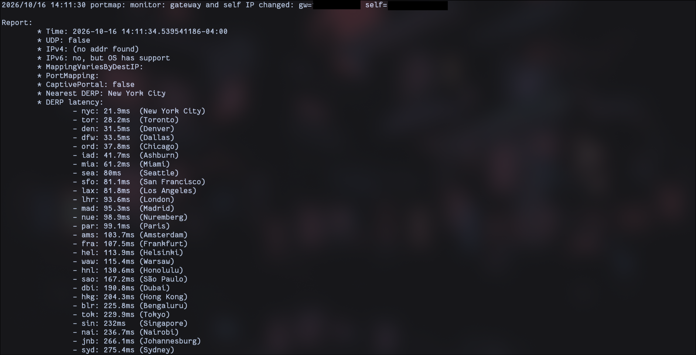

- **Root cause:** WireGuard, which both Tailscale and Mullvad use, runs over UDP. When UDP is blocked, Tailscale falls back to its **DERP relay servers over TCP 443 (HTTPS)** for traffic between my own devices. That's why RDP kept working, still end-to-end encrypted with WireGuard; the relay only passes along packets it can't decrypt. The Mullvad exit node, however, didn't work without a direct UDP connection.
- **Workaround:** made the Windows host a temporary exit node. Its traffic to the laptop rides the same HTTPS relay that RDP uses.
  1. **Windows** (over RDP, admin PowerShell). A device can't use an exit node and advertise one at the same time, so Mullvad comes off first:
     ```powershell
     tailscale set --exit-node= --advertise-exit-node
     ```
  2. **Admin console:** Machines → Windows host → **Edit route settings** → tick **Use as exit node**. Without this approval, Fedora reported the host as *not advertising as an exit node*.
  3. **Fedora:**
     ```bash
     tailscale set --exit-node=<WINDOWS_TAILSCALE_IP> --exit-node-allow-lan-access=true
     tailscale status    # Windows row shows "relay", as expected on a UDP-blocked network
     ```

  

- **Trade-off:**

  | Observer | Mullvad exit node (normal) | Home exit node (this workaround) |
  |---|---|---|
  | Public Wi-Fi operator | Encrypted traffic only | Encrypted traffic to Tailscale's relay only |
  | Home ISP | Encrypted traffic only | Which sites I visit (not page contents) |
  | Websites | A Mullvad IP | My home IP |
  | Windows host's own traffic | Through Mullvad | Not through Mullvad while advertising |

  The untrusted network is fully covered. What's lost is the extra privacy from Mullvad: my ISP sees destinations, and websites see my home connection.

- **Options evaluated for keeping Mullvad on UDP-blocked networks:**

  | Option | Outcome |
  |---|---|
  | Standalone Mullvad app with obfuscation (disguises WireGuard traffic as TCP) | Gets past UDP blocks, but needs a second subscription and conflicts with Tailscale (see Issue 3) |
  | Dedicated Linux exit node at home (e.g., an old Chromebook) running Mullvad's WireGuard config plus Tailscale | Works, but needs a standalone Mullvad account and manual routing |
  | VPN router at home running a Mullvad WireGuard client | Every home device, including the exit node, exits through Mullvad; also needs a standalone account |
  | Tor Browser through the home exit node | Free, hides browsing from the ISP and websites; browser-only and slow |
  | **Home exit node as an occasional fallback** | ✅ Chosen for now. UDP-blocked networks are the exception, not the norm |

- **Revert when back on a normal network:**
  ```powershell
  # Windows
  tailscale set --advertise-exit-node=false --exit-node=<mullvad-node> --exit-node-allow-lan-access=true
  ```
  ```bash
  # Fedora
  tailscale set --exit-node=<mullvad-node> --exit-node-allow-lan-access=true
  ```
- **Lesson:** Know what your tools need from the network. WireGuard needs UDP, and restrictive networks block it. Tailscale's relays keep device-to-device access alive, but a third-party exit node won't follow. A fallback plan is part of the design, not an afterthought.


---

## 6. Final Configuration Summary

| Component           | Configuration                                                                               |
| ------------------- | ------------------------------------------------------------------------------------------- |
| Windows 11 Pro      | RDP on, NLA on, Hello-only sign-in off, never sleeps when plugged in                        |
| Windows Firewall    | RDP allowed only from `100.64.0.0/10` (Tailscale)                                           |
| Tailscale (Windows) | Run unattended, key expiry disabled, Mullvad exit node, LAN access allowed, not advertising |
| Tailscale (Fedora)  | Official repo, user set as operator, Mullvad exit node, LAN access allowed                  |
| RDP client          | FreeRDP (`xfreerdp`) with TOFU certificate pinning; Remmina profile as a GUI alternative    |
| VPN                 | Mullvad via Tailscale add-on; standalone Mullvad app retired                                |
| Fallback            | Windows host as exit node on UDP-blocked networks (see Issue 5)                             |

---

## 7. Verification Checklist

- [x] `curl ifconfig.me` on Fedora shows a Mullvad IP
- [x] `curl.exe ifconfig.me` on Windows shows a Mullvad IP
- [x] mullvad.net/check passes on both machines
- [x] RDP from Fedora to Windows works with Mullvad active on both
- [x] RDP port blocked on LAN IP, open on Tailscale IP
- [x] RDP works from a public Wi-Fi
- [x] Windows reboot: exit node and RDP access persist

---

## 8. Lessons Learned

- **Debug layer by layer.** Network reachability, transport, and authentication fail with different errors. Identifying the layer first saved a lot of guessing.
- **Logs are evidence.** The received certificate in the FreeRDP output was the clue that the network was fine.
- **Know your threat model.** A home exit node protects against public Wi-Fi but not against my ISP. Only a third-party exit point (Mullvad) does both.
- **Avoid fragile setups on remote machines.** If a configuration can break on reboot, it will break while you're away.
- **Overlay networks ≠ VPN providers.** Tailscale connects my devices to each other; Mullvad hides my traffic from the outside world. They solve different problems.
- **WireGuard needs UDP.** Restrictive networks block it. Tailscale's relays keep my own devices connected, but third-party exit nodes don't follow.

---

## 9. Future Improvements

- [ ] Set laptop lid-close action to *Do nothing* when plugged in, so the Windows laptop stays reachable
- [x] Add Tailscale to my Android phone with a Mullvad exit node, plus Android's *Always-on VPN* and *Block connections without VPN*
- [ ] Write Tailscale ACLs so only my Fedora machine can reach the Windows machine on 3389
- [ ] Explore MFA for remote access (e.g., Tailscale SSH or a device-posture check)
- [ ] Set up an old Chromebook as a Linux file server (NAS) on the tailnet
- [ ] Dedicated Mullvad exit node at home (Linux box or VPN router) so Mullvad works even on UDP-blocked networks

---

## 10. Skills Demonstrated

`Remote Desktop Protocol` · `FreeRDP / Remmina` · `Tailscale / WireGuard` · `VPN & exit node routing` · `Windows Firewall (PowerShell)` · `Windows account & authentication policy` · `Linux administration (Fedora, dnf, systemd)` · `Log analysis & layered troubleshooting` · `Threat modeling` · `Technical documentation`
